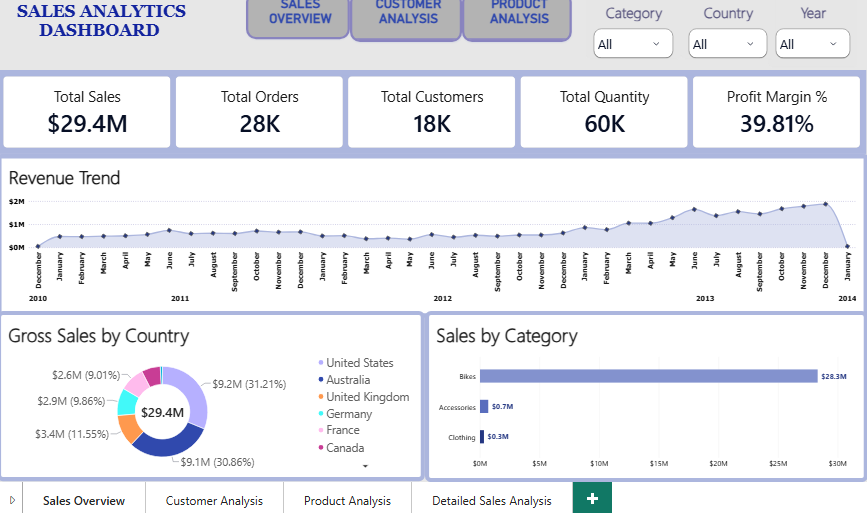
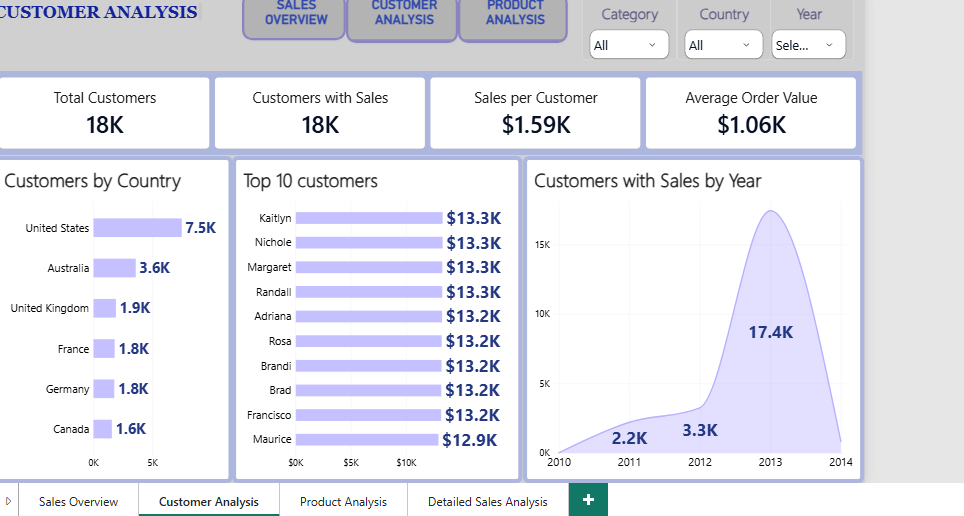
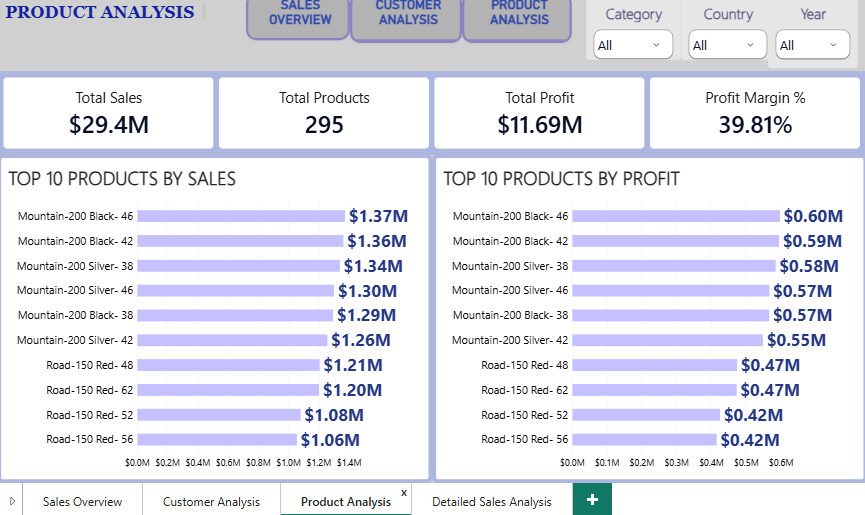
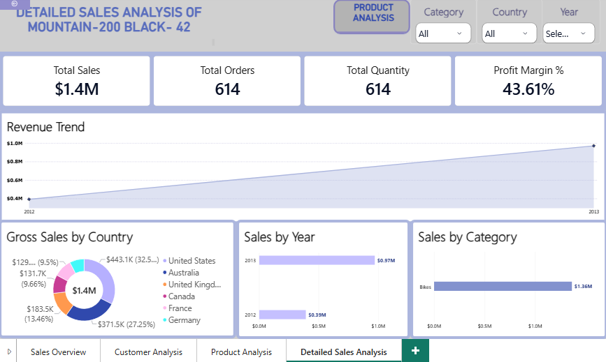

# Sales Analytics Dashboard (SQL Data Warehouse & Power BI)

A Microsoft Power BI business intelligence dashboard built on top of the **Gold Layer** views of an end-to-end SQL Data Warehouse project . The dashboard provides executive visibility into sales performance, customer behavior, product profitability, and drill-through item analytics.

The customer base spans **6 countries**: United States, Australia, United Kingdom, Germany, France, and Canada. Sales and order data covers the period from **December 2010 to January 2014**, evaluating **28K orders**, **18K customers**, and **295 products** across Bikes, Accessories, and Clothing.

## Features

- **Executive Sales Tracking:** Monitor top-line KPIs including Total Sales ($29.4M), Total Orders (28K), Total Customers (18K), Total Quantity (60K), and Profit Margin % (39.81%).
- **Geographic & Category Breakdown:** Compare gross sales and customer distribution across 6 countries and 3 core product categories.
- **Customer & Cohort Insights:** Track active customer acquisition trends over time, average order value, and top revenue-generating customers.
- **Product & Drill-Through Analytics:** Evaluate top-performing products by revenue and profit, with dedicated drill-through analysis for individual product SKUs.

## Project Highlights

This project involved the following end-to-end data engineering and BI tasks:

- **SQL Data Warehouse Gold Layer Integration:** Connected Power BI directly to curated analytical views (`FactSales`, `DimProducts`, `DimCustomers`) modeled in a Star Schema.
- **Star Schema Data Modeling:** Configured active and inactive relationships between `FactSales` and dimension tables (`DimProducts`, `DimCustomers`, and a custom `DimDate` calendar table) to support order date, due date, and shipping date analysis.
- **DAX Calculations & Measures:** Built a dedicated `MeasuresTable` containing custom DAX measures for Profit Margin %, Average Order Value, Average Selling Price, Average Shipping Days, Sales MTD, Sales per Customer, and Dynamic Titles.
- **Interactive Navigation & UX:** Implemented custom page navigation buttons, global slicers (Category, Country, Year), and dynamic page titles.

## Dashboard Elements
#### 1. Sales Overview
- High-level KPI cards for Total Sales, Total Orders, Total Customers, Total Quantity, and Profit Margin %.
- Monthly Revenue Trend area chart tracking growth from December 2010 through January 2014.
- Gross Sales by Country donut chart and Sales by Category horizontal bar chart.

#### 2. Customer Analysis
- Customer-centric KPI cards showing Total Customers (18K), Customers with Sales (18K), Sales per Customer ($1.59K), and Average Order Value ($1.06K).
- Geographic distribution ranking Customers by Country.
- Top 10 Customers leaderboard ranked by total purchase value.
- Customers with Sales by Year area chart illustrating customer acquisition spikes.

#### 3. Product Analysis
- Product portfolio KPIs tracking Total Sales ($29.4M), Total Products (295), Total Profit ($11.69M), and Profit Margin % (39.81%).
- Side-by-side comparison charts displaying **Top 10 Products by Sales** and **Top 10 Products by Profit**.

#### 4. Detailed Sales Analysis (Drill-Through)
- Dynamic report page (e.g., *Detailed Sales Analysis of Mountain-200 Black-42*) powered by a DAX `Dynamic Title` measure.
- Product-specific KPIs (Total Sales, Total Orders, Total Quantity, Profit Margin %), multi-year Revenue Trend, Gross Sales by Country, and annual sales breakdown.

## Key Insights

- **Strong Revenue & Margin Performance:** Between December 2010 and January 2014, the business generated **$29.4M in total sales** and **$11.69M in total profit**, maintaining a healthy overall **profit margin of 39.81%**.
- **2013 Growth Surge:** Revenue remained steady between ~$0.4M and ~$0.7M per month throughout 2011 and 2012 before surging significantly in 2013, peaking in **December 2013 at nearly $2M**. Correspondingly, active customers jumped from **3.3K in 2012 to 17.4K in 2013**.
- **Bikes Dominate Category Revenue:** **Bikes** generate **$28.3M** (over 96% of total revenue), far outpacing **Accessories ($0.7M)** and **Clothing ($0.3M)**.
- **Top Revenue & Profit Drivers:** The **Mountain-200** and **Road-150** series dominate both revenue and profit leaderboards. **Mountain-200 Black-46** is the #1 product overall, generating **$1.37M in sales** and **$0.60M in profit**, followed closely by **Mountain-200 Black-42** ($1.36M sales, $0.59M profit).
- **Geographic Concentration:** The **United States** ($9.2M / 31.21%) and **Australia** ($9.1M / 30.86%) together account for over **62% of gross sales**. The United States also leads in customer volume with **7.5K customers**, more than double second-place Australia (**3.6K customers**).
- **Consistent High-Value Customers:** The top 10 individual customers each contributed between **$12.9K and $13.3K** in lifetime sales (led by Kaitlyn, Nichole, Margaret, and Randall at $13.3K each), well above the overall average sales per customer of **$1.59K**.
